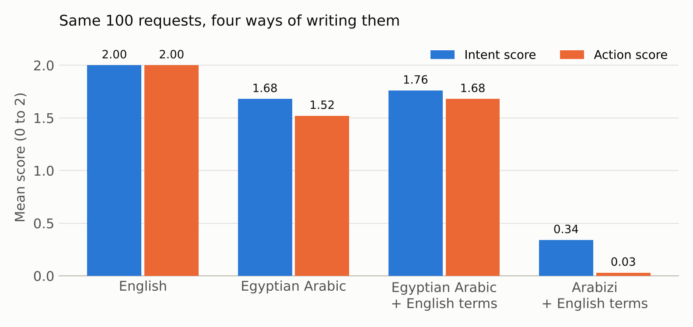

# Egyptian Arabic, Code-Switching and Arabizi Consistency Benchmark



A 400-example benchmark that writes the same 100 customer-support requests in four forms of everyday Egyptian communication, used to test whether a language model keeps the same understanding of a request when only its written form changes. It comes with the responses of [Qwen/Qwen3-4B-Instruct-2507](https://huggingface.co/Qwen/Qwen3-4B-Instruct-2507) and hand-assigned scores.

**Author:** Nouran Mohamed El-Sayed (Ain Shams University, Cairo) · **Created:** October 2026

## Why this benchmark

Egyptians often mix Egyptian Arabic and English in one sentence, write Arabic in Latin letters and numbers (Arabizi), and adapt English words into Arabic ("اكنسل" for "cancel"). Standard benchmarks tend to test languages separately with clean, formal text, so they do not show whether a model's understanding of a task survives these changes. In customer support, a small shift in interpretation can lead to the wrong action, an unnecessary question or an unsupported assumption.

The idea grew out of a mentorship with Prof. Ahmed Hassan Yousef and his work on Arabic sentiment analysis and summarization.

## Design

100 scenarios, each written in four conditions, so that the meaning stays fixed and only the form changes:

| Condition | Example (scenario S001) |
|---|---|
| English | Can you check why this order is stuck? |
| Egyptian Arabic | ممكن تبصلي ليه الأوردر واقف؟ |
| Egyptian Arabic + English terms | ممكن تبصلي ليه الـ order stuck؟ |
| Arabizi + English terms | momken tebosly leh el order stuck? |

- **Scope:** 85 in-scope operational scenarios (orders, delivery, returns, refunds, payments, promotions, pricing, accounts, account security, subscriptions, app sync, rewards and more) and 15 out-of-scope requests (for example legal, medical or creative requests) that a support assistant should not try to fulfil.
- **Difficulty:** easy, medium and hard, plus edge cases such as typos, missing punctuation, abbreviations, sarcasm, emotional or threatening tone, multiple issues in one message, letter elongation and mixed script.
- **Gold labels per scenario:** intended issue (`gold_intent`), urgency, the expected next action, and a forbidden assumption the model must not make (for example "Never request the customer's OTP").

## Repository layout

```
data/
  benchmark_400_prompts.csv      the 400 prompts and gold labels
  results_400.csv                prompts + model responses + hand scores + evaluator notes
  q1_transliteration_sheet.csv   Arabizi requests rewritten word for word in Arabic script (next experiment)
notebooks/
  qwen3_4b_egyptian_arabic_evaluation.ipynb   builds the benchmark, runs the model, summarizes scores
scripts/
  summarize.py                   recomputes the results table and failure breakdown
figures/
  results_by_condition.png
```

To reproduce the tables: `pip install pandas` then `python scripts/summarize.py`. The overall intent mean is 1.445, reported as 1.45.

## Files

| File | Contents |
|---|---|
| `data/benchmark_400_prompts.csv` | The 400 prompts with all gold labels and a `data_note` column (see Known issues). |
| `data/results_400.csv` | The prompts plus the model's response and the scores. |
| `notebooks/qwen3_4b_egyptian_arabic_evaluation.ipynb` | Code that builds the benchmark and runs the model. |

### Columns

`example_id`, `scenario_id`, `category`, `scope`, `condition`, `difficulty`, `edge_case`, `prompt`, `gold_intent`, `gold_urgency`, `expected_action`, `forbidden_assumption`, and in the results file also `model_response`, `intent_score`, `action_score`, `unsupported_action`, `evaluator_notes`.

## Evaluation setup

- **Model:** Qwen/Qwen3-4B-Instruct-2507, loaded with `transformers`.
- **Prompting:** each prompt sent on its own as a single user message, with no system prompt.
- **Decoding:** greedy (`do_sample=False`), up to 300 new tokens.
- **Scoring:** every response scored by hand by the author on a 0 to 2 scale for two criteria, plus a count of unsupported actions.
  - **Intent:** did the model identify the user's underlying issue?
  - **Action:** did it propose an appropriate next step?
  - 0 = fully incorrect, 1 = partly correct or incomplete, 2 = fully correct.
  - **Unsupported action:** did it claim or do something it could not know or should not do (the scenario's forbidden assumption)?

## Results

| Condition | Examples | Intent | Action | Unsupported actions |
|---|---|---|---|---|
| English | 100 | 2.00 | 2.00 | 0 |
| Egyptian Arabic | 100 | 1.68 | 1.52 | 0 |
| Egyptian Arabic + English | 100 | 1.76 | 1.68 | 0 |
| Arabizi + English | 100 | 0.34 | 0.03 | 0 |
| **Overall** | 400 | 1.45 | 1.31 | 0 |

The model handled English perfectly and Egyptian Arabic in Arabic script reasonably well, but performance collapsed in Arabizi: only 2 of the 100 Arabizi requests got a fully correct intent score, and 1 a fully correct action. No unsupported actions were recorded in any condition.

### How the Arabizi responses failed

Grouped from the evaluator notes on the 100 Arabizi + English responses:

| Failure type | Responses |
|---|---|
| Decided the message was another language (often Welsh or Portuguese) or garbled text | 43 |
| Treated the message as a language task, translating or analyzing it instead of helping | 34 |
| Misread "mesh" (Egyptian for "not") as AWS App Mesh, a 3D mesh or a mesh network | 14 |
| Misread other words (for example "wesel", "arrived", taken as the name of the item) | 5 |
| Triggered an unwarranted safety refusal | 3 |
| Fully correct | 1 |

In Arabic script the failures were different and rarer: asking the user to rephrase Egyptian slang, answering as a translator, or misreading a word's meaning. In scenario S001 both Arabic-script versions ("الأوردر واقف" and "الـ order stuck") were read as a stock-trading order.

The Arabic-script and Arabizi versions of most scenarios use nearly the same words (75 of the 100 pairs have the same word count), so the drop from 1.76 to 0.34 between those two conditions comes largely from the change of script, not from a change of dialect.

## Known issues and limitations

- **One model, one domain, one annotator.** The scores are evidence from this benchmark only, not a general measure of the model's Arabic ability, and no inter-annotator agreement was measured.
- **Grouping of failure types.** The table above groups the evaluator's free-text notes into categories after the fact; each response was assigned to one group.
- **Synthetic requests.** All scenarios were written by the author, not collected from real users.
- **Seven Arabizi prompts contain Arabic-script words** that were not intended (E080, E096, E244, E248, E264, E356, E396). E328 is mixed script on purpose (`edge_case = mixed_script`).
- **Fourteen "Egyptian Arabic" prompts contain English words** (for example "refund", "sync", "tracking"), so that condition is not purely Arabic. This reflects how these words are used in Egyptian Arabic, but it narrows the difference between conditions 2 and 3.
- **Eight rows use difficulty `high`** (scenarios S046 and S050) instead of easy/medium/hard.

These rows are flagged in the `data_note` column and were not changed, so the published scores still match the prompts the model saw.

## Planned next steps

1. **Script or dialect?** Re-run the 100 Arabizi requests after an exact, hand-made transliteration into Arabic script, to measure how much of the gap the script alone explains.
2. **Scale:** run the same benchmark across model sizes and families.
3. **Consistency training:** build paired data in which one request appears in many realistic forms and test whether consistency-based training narrows the gap.
4. **Automatic judges:** measure whether an LLM judge agrees with human scores on Arabizi responses.

## Citation

```bibtex
@misc{elsayed2026arabizi,
  author = {El-Sayed, Nouran Mohamed},
  title  = {Egyptian Arabic, Code-Switching and Arabizi Consistency Benchmark},
  year   = {2026},
  howpublished = {\url{https://github.com/nour-rayann/egyptian-arabizi-consistency}}
}
```

## License

Data (`data/`, `figures/`) is released under [CC BY 4.0](https://creativecommons.org/licenses/by/4.0/). Code (`notebooks/`, `scripts/`) is released under the MIT License (see `LICENSE`).
