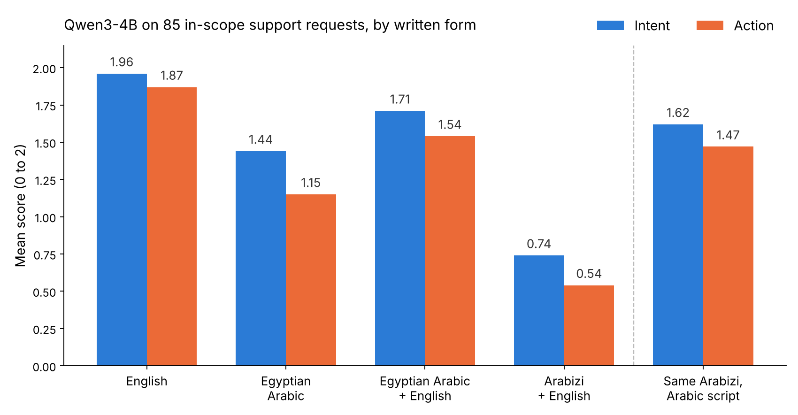
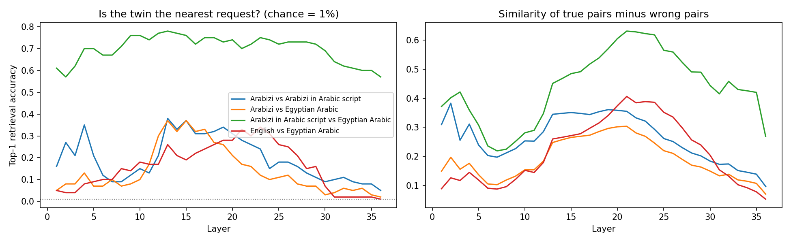
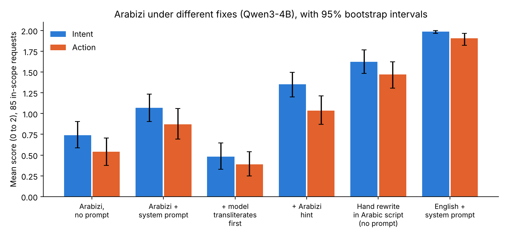

# Egyptian Arabic, Code-Switching and Arabizi Consistency Benchmark

[](https://colab.research.google.com/github/nour-rayann/egyptian-arabizi-consistency/blob/main/notebooks/qwen3_4b_egyptian_arabic_evaluation.ipynb)



A 400-example benchmark that writes the same 100 customer-support requests in four forms of everyday Egyptian communication, used to test whether a language model keeps the same understanding of a request when only its written form changes. It comes with the responses of [Qwen/Qwen3-4B-Instruct-2507](https://huggingface.co/Qwen/Qwen3-4B-Instruct-2507), their scores, and a follow-up test that rewrites the Arabizi requests in Arabic script.

**Author:** Nouran Mohamed El-Sayed (Ain Shams University, Cairo) · **Created:** October 2026 · **Results last revised:** 21 November 2026

> **Update (21 November 2026).** Added a spelling-variation test (respelled Arabizi did not do better, and slightly worse) and two checks of scoring reliability: a blind self re-score of 100 answers and agreement between the LLM judge's first pass and the hand-checked scores. The main tables did not change.

> **Update (20 November 2026).** Added three follow-up runs on Qwen3-4B, all hand-checked: a support-assistant system prompt, an Arabizi hint, and asking the model to rewrite Arabizi in Arabic script before answering (see "Follow-up: does telling the model more fix the gap?" below). The main tables did not change.

> **Update (17 November 2026).** Added a hidden-state analysis comparing how the model represents the same request in different forms, with a control comparison against pure Egyptian Arabic (see "Inside the model" below). No scores changed.

> **Update (15 November 2026).** Fourteen "Egyptian Arabic" prompts had English words in Latin letters (for example "refund", "sync", "tracking"), so that condition was not purely in Arabic script. They were rewritten with the same English words in Arabic letters (ريفاند، سينك، التراكر), run again with the same model and settings, and scored again. The earlier prompts, answers and scores are kept in the `_v1` columns of `data/results_400.csv`. Egyptian Arabic scores fell (in-scope intent from 1.52 to 1.44, action from 1.26 to 1.15); no other condition changed. The difficulty of scenarios S046 and S050 was corrected from `high` to `medium`, and a missing urgency label (E020) in `data/benchmark_400_prompts.csv` was restored.

> **Correction (18 October 2026).** An earlier version of this repository reported results from a spreadsheet in which most model responses could not be traced to the prompts they sat next to: 219 of the 400 responses were exact copies of another row's response, and many belonged to a different prompt. Those results, including an Arabizi intent score of 0.34 and a failure breakdown dominated by "Welsh or Portuguese" and "AWS App Mesh" readings, are withdrawn. All 400 prompts were run again with the same model and settings, and every response was scored again. The tables below come from that run.

## Why this benchmark

Egyptians often mix Egyptian Arabic and English in one sentence, write Arabic in Latin letters and numbers (Arabizi), and adapt English words into Arabic ("اكنسل" for "cancel"). Standard benchmarks tend to test languages separately with clean, formal text, so they do not show whether a model's understanding of a task survives these changes. In customer support, a small shift in interpretation can lead to the wrong action, an unnecessary question or an unsupported assumption.

The idea grew out of a mentorship with Prof. Ahmed Hassan Yousef (https://scholar.google.com/citations?hl=en&user=OVwUxWQAAAAJ&view_op=list_works&is_public_preview=1) and his work on Arabic sentiment analysis and summarization.

## Design

100 scenarios, each written in four conditions, so that the meaning stays fixed and only the form changes:

| Condition | Example (scenario S001) |
|---|---|
| English | Can you check why this order is stuck? |
| Egyptian Arabic | ممكن تبصلي ليه الأوردر واقف؟ |
| Egyptian Arabic + English terms | ممكن تبصلي ليه الـ order stuck؟ |
| Arabizi + English terms | momken tebosly leh el order stuck? |

- **Scripts:** the Egyptian Arabic condition uses Arabic script only; English loanwords are written in Arabic letters, as Egyptians often write them (الأوردر، ريفاند). The other two Egyptian conditions keep English terms in Latin letters.
- **Scope:** 85 in-scope operational scenarios (orders, delivery, returns, refunds, payments, promotions, pricing, accounts, account security, subscriptions, app sync, rewards and more) and 15 out-of-scope requests (for example legal, medical or creative requests) that a support assistant should not try to fulfil.
- **Difficulty:** easy, medium and hard, plus edge cases such as typos, missing punctuation, abbreviations, sarcasm, emotional tone, several issues in one message, letter elongation and mixed script.
- **Gold labels per scenario:** intended issue (`gold_intent`), urgency, the expected next action, and a forbidden assumption the model must not make (for example "Never request the customer's OTP").

## Repository layout

```
data/
  benchmark_400_prompts.csv       the 400 prompts and gold labels
  results_400.csv                 prompts + model responses + scores + response type
                                  (_v1 columns: earlier versions of the 14 rewritten prompts)
  q1_transliteration_sheet.csv    the 100 Arabizi requests rewritten word for word in Arabic script
  q1_script_test_results.csv      the model's answers to those rewritten requests, with scores
  hidden_state_control.csv        twin-retrieval accuracy and similarity gap per layer, for four pairs of conditions
  hidden_state_similarity.csv     first hidden-state run (Arabizi vs Arabic-script rewrite only)
  followup_experiments_scored.csv system prompt, Arabizi hint and transliterate-first runs, with scores
  arabizi_spelling_variants.csv   respelled Arabizi requests, checked by the author (83 variants)
  spelling_variants_scored.csv    the model's answers to the respelled requests, with scores
  blind_rescore.csv               100 answers re-scored blind by the author, with their original IDs
  followup_llm_first_pass.csv     the LLM judge's first-pass scores for the 600 follow-up answers
notebooks/
  qwen3_4b_egyptian_arabic_evaluation.ipynb   builds the benchmark, runs the model, summarizes scores
  extensions.ipynb                code for the planned follow-up experiments (see Next steps)
scripts/
  summarize.py                    recomputes every table in this README
  stats.py                        confidence intervals and paired significance tests
  followup_stats.py               tables, tests and chart for the follow-up runs
  make_annotation_sheet.py        builds a blinded sheet for re-scoring a sample
  agreement.py                    agreement with a second annotator (Cohen's kappa)
  self_agreement.py               blind self re-score and LLM-judge agreement
  spelling_stats.py               tables and tests for the spelling-variation test
  make_spelling_variants.py       builds the rule-based spelling variants before checking
figures/
  results_by_condition.png
  hidden_state_control.png
  hidden_state_similarity.png
  followup_arabizi.png
```

To reproduce the tables: `pip install pandas` then `python scripts/summarize.py`. For the intervals and tests: `pip install pandas numpy scipy` then `python scripts/stats.py`. For the follow-up runs: `pip install pandas numpy scipy matplotlib` then `python scripts/followup_stats.py`.

## Evaluation setup

- **Model:** Qwen/Qwen3-4B-Instruct-2507, loaded with `transformers`.
- **Prompting:** each prompt sent on its own as a single user message, with no system prompt.
- **Decoding:** greedy (`do_sample=False`), up to 300 new tokens.
- **Scoring:** each response gets two scores on a 0 to 2 scale (0 = incorrect, 1 = partly correct or incomplete, 2 = correct) and an unsupported-action flag.
  - **Intent:** did the model identify the user's underlying issue? Restating the meaning correctly but treating the message as text to translate, rather than as a request, scores 1.
  - **Action:** did it propose an appropriate next step for that issue (asking for the order number, giving the right troubleshooting steps, or, for out-of-scope requests, declining and redirecting)?
  - **Unsupported action:** did it make the scenario's forbidden assumption (for example inventing a store policy, or acting as a travel planner)?
- **Who scored:** first-pass scores were assigned by an LLM judge following the rubric above, and every score was then checked by hand by the author. Each response also has a `response_type` label describing what the model did.

Because there is no system prompt, the model has no way of knowing that it is meant to be a support assistant. On the 15 out-of-scope requests it therefore usually just fulfils the request (recommending restaurants, planning a trip), in every condition. The main table uses the 85 in-scope requests for that reason; the all-100 table is given below it.

## Results

### Main table: 85 in-scope requests per condition

| Condition | Intent | Action | Unsupported actions |
|---|---|---|---|
| English | 1.96 | 1.87 | 1 |
| Egyptian Arabic | 1.44 | 1.15 | 1 |
| Egyptian Arabic + English | 1.71 | 1.54 | 0 |
| Arabizi + English | 0.74 | 0.54 | 0 |
| *Arabizi + English, rewritten in Arabic script* | *1.62* | *1.47* | *0* |

In English the model almost always understood the request. In Egyptian Arabic written fully in Arabic script it dropped, and keeping the English terms in Latin letters helped: intent rose from 1.44 to 1.71. In Arabizi it understood far fewer requests: it got the intent fully right for 15 of the 85, and for 37 it got it completely wrong.

### How sure are these numbers?

Each scenario appears in every condition, so conditions can be compared scenario by scenario. Intervals are 95% bootstrap intervals over the 85 in-scope scenarios; p-values are Wilcoxon signed-rank tests, Holm-corrected within each score.

| Condition | Intent | Action | Intent fully correct |
|---|---|---|---|
| English | 1.96 [1.92, 2.00] | 1.87 [1.78, 1.94] | 96% |
| Egyptian Arabic | 1.44 [1.27, 1.59] | 1.15 [0.96, 1.33] | 60% |
| Egyptian Arabic + English | 1.71 [1.58, 1.82] | 1.54 [1.39, 1.68] | 76% |
| Arabizi + English | 0.74 [0.59, 0.91] | 0.54 [0.39, 0.71] | 18% |
| *Arabizi + English, rewritten in Arabic script* | *1.62 [1.48, 1.75]* | *1.47 [1.31, 1.62]* | *73%* |

- **Arabizi against its Arabic-script rewrite:** intent +0.88 [+0.71, +1.06], higher in 54 scenarios and lower in 2 (p < 0.001); action +0.93 [+0.74, +1.13] (p < 0.001).
- **The rewrite against the Egyptian Arabic + English condition:** intent differs by 0.08 [−0.01, +0.19] (p = 0.10), so the remaining gap cannot be told apart from zero.
- **English against Arabizi:** intent +1.22 [+1.06, +1.38] (p < 0.001). English never scored lower than Arabizi on intent.
- **Egyptian Arabic against Egyptian Arabic + English:** keeping English terms in Latin letters helped, intent +0.27 [+0.12, +0.44] (p = 0.003), action +0.39 [+0.21, +0.56] (p < 0.001).

### Is the gap about script or dialect?

Each Arabizi request was rewritten word for word in Arabic script, keeping the English words in Latin letters (`data/q1_transliteration_sheet.csv`), and the model was run again with the same settings. The words and the dialect stayed the same; only the script changed.

- Intent rose from 0.74 to 1.62, and action from 0.54 to 1.47. That closes about 90% of the gap to the Egyptian Arabic + English condition (1.71 and 1.54).
- The rewritten version scored higher on intent in 62 of the 100 scenarios and lower in 2.
- For 65 scenarios the rewritten request turned out to be identical to the existing "Egyptian Arabic + English" prompt, and with greedy decoding the model gave exactly the same answer to both. On the other 35, where the wording differs slightly, the result holds: intent 0.80 in Arabizi against 1.46 in Arabic script. On the 27 of these that are in scope, intent rose from 0.63 to 1.33 (p = 0.001).
- Token counts are almost the same (13.8 tokens on average for Arabizi, 13.4 for Arabic script), so Arabizi is not simply split into more pieces.

In this benchmark, then, most of the Arabizi gap comes from the Latin script rather than from the dialect. Reading the answers suggests why: the model often reads Latin-spelled Egyptian words as words of another language.

### English words written in Arabic letters

The 14 rewritten Egyptian Arabic prompts (see the update above) give a small test in the opposite direction: the same English loanwords, first in Latin letters and then in Arabic letters, with the rest of the sentence unchanged. On the 12 in-scope prompts, intent fell from 1.58 to 1.00 and action from 1.33 to 0.58; intent was lower in 6 prompts and higher in 1.

The model read ريفاند (refund) as a replacement, a product or "Re-Validation" (E082, E086, E286), or could not make sense of it (E114). It read فيتشر (feature) as an app called "Vitshir" (E262), التراكر (tracking) as a GPS tracker (E026) and, in an out-of-scope request, السي في (CV) as a legal document (E362). ريسيت (reset) and سينك (sync) were understood (E166, E242).

With 12 prompts this is an observation rather than a measured effect, but it points the same way as the Arabizi result: each kind of word was understood best in the script it is usually written in, Egyptian words in Arabic letters and English words in Latin letters.

### What the model did with the 100 Arabizi requests

| Response type | Count | Examples |
|---|---|---|
| Answered correctly | 12 | |
| Misread an Egyptian word | 21 | "ma weselsh" (did not arrive) read as Welsh (E168); "8alat" (wrong) read as the number 80 (E308); "bet2abloha" read as a betting site (E104) |
| Treated the request as a language task, translating or analyzing it instead of helping | 15 | E008, E012, E088 |
| Took it for another language and often answered in it (Spanish, Portuguese, Indonesian, Filipino, French) | 14 | Portuguese (E016), Spanish (E060), Indonesian (E240), Filipino (E360) |
| Said the message was unclear and asked for a rephrase | 9 | E004, E036 |
| Read "mesh" (Egyptian for "not") as AWS App Mesh, a 3D mesh or a mesh network | 7 | App Mesh (E244, E328), 3D mesh (E028) |
| Read a support word in a technical sense | 5 | `return` as the Python statement (E048, E052) |
| Understood the request but gave an incomplete next step | 5 | |
| Refused for no reason ("If this is a question involving false or bad content...") | 4 | E180, E296, E340 |
| Produced repetitive, broken output | 2 | E064, E300 |
| Fulfilled an out-of-scope request (as in the other conditions) | 6 | |

Arabic script had problems of its own, and some of them appear in every Arabic condition. "الأوردر واقف" (the order is stuck) was read as a stock-trading order (E002, E003), "return" as the Python statement (E050, E051), "اتخصم مني" (I was charged) as a discount (E090), and "بطل يشتغل" (stopped working) as a product called "Batal" (E070).

### Inside the model: how close are the different forms of one request?

For every prompt, the hidden state of the last token was taken at each of the model's 36 layers. The states were centred on their mean, and each request was compared, by cosine similarity, with all 100 requests of another condition. A pair counts as found when the most similar request is its own twin (the same scenario). Chance is 1%.



| Pair | Best twin retrieval | At last layer |
|---|---|---|
| Arabizi vs its Arabic-script rewrite | 38% (layer 13) | 5% |
| Arabizi vs Egyptian Arabic | 37% (layer 13) | 2% |
| Arabic-script rewrite vs Egyptian Arabic | 78% (layer 13) | 57% |
| English vs Egyptian Arabic | 34% (layer 23) | 1% |

- **Shared English words are not the whole link.** The Arabizi and Arabic-script versions share their English words in Latin letters, so a match between them could come from those words alone. Pure Egyptian Arabic shares no Latin-letter words with Arabizi, yet Arabizi found its Egyptian Arabic twin about as often (37% against 38%). In the middle layers, the model partly connects the Egyptian words in an Arabizi message to the same request in Arabic script.
- **The link fades.** By the last layer Arabizi finds its twin 2% to 5% of the time. The two Arabic-script versions stay close to the end (57%).
- **It does not predict the answers.** At layer 13, how similar an Arabizi request was to its Egyptian Arabic twin did not track its intent score (Spearman 0.05, p = 0.63).

This describes how close the representations are; it does not show where or why the model misreads Arabizi.

### Follow-up: does telling the model more fix the gap?

Three follow-up runs on Qwen3-4B, with the same decoding settings and the same scoring (an LLM judge's first pass, then every score checked by hand; 120 of the 600 first-pass scores were changed). Data: `data/followup_experiments_scored.csv`. To reproduce the numbers and the chart: `python scripts/followup_stats.py`.

- **System prompt:** all 400 prompts with the system prompt "You are a customer support assistant for an online store. Help the customer with their request."
- **Arabizi hint:** the 100 Arabizi prompts with the same system prompt plus one sentence: customers may write in English, Egyptian Arabic, or Egyptian Arabic in Latin letters and numbers (Arabizi, where 3 = ع, 7 = ح, 2 = ء, 5 = خ, 8 = غ), often mixed with English words.
- **Transliterate first:** the model is first asked to rewrite each Arabizi request in Arabic script, keeping English words as they are, and then answers its own rewrite with the same system prompt.



| Setting (85 in-scope requests) | Intent | Action |
|---|---|---|
| Arabizi, no system prompt (main table) | 0.74 [0.59, 0.91] | 0.54 [0.39, 0.71] |
| Arabizi, system prompt | 1.07 [0.91, 1.24] | 0.87 [0.69, 1.05] |
| Arabizi, system prompt + hint | 1.35 [1.20, 1.49] | 1.04 [0.86, 1.21] |
| Arabizi, system prompt + model transliterates first | 0.48 [0.33, 0.65] | 0.39 [0.25, 0.54] |
| *Arabizi rewritten in Arabic script by hand, no system prompt* | *1.62 [1.48, 1.75]* | *1.47 [1.31, 1.62]* |
| English, system prompt | 1.99 [1.96, 2.00] | 1.91 [1.84, 1.96] |
| Egyptian Arabic, system prompt | 1.59 [1.44, 1.73] | 1.44 [1.27, 1.59] |
| Egyptian Arabic + English, system prompt | 1.88 [1.80, 1.95] | 1.76 [1.65, 1.87] |

p-values below are paired Wilcoxon signed-rank tests, Holm-corrected over the 11 comparisons the script makes for each score.

- **The gap survives a system prompt.** The prompt helped every Arabic form a little; Arabizi intent rose from 0.74 to 1.07 (higher in 30 scenarios, lower in 4, p < 0.001) and English did not change (p = 0.32). Arabizi stayed 0.92 below English (lower in 56 scenarios, higher in none, p < 0.001) and 0.81 below Egyptian Arabic + English (p < 0.001). Keeping English terms in Latin letters still helped (Egyptian Arabic 1.59 against 1.88, p = 0.004).
- **It changed how Arabizi failed, not how often words were misread.** With the system prompt, answers that translated or analyzed the message instead of helping fell from 15 to 1, and readings of support words in a technical sense (such as `return` as Python) disappeared. Misread Egyptian words stayed at 16, and "I didn't understand, please rephrase" rose from 9 to 23.
- **The hint helps, but less than fixing the script.** On top of the system prompt it raised Arabizi intent from 1.07 to 1.35 (higher in 27, lower in 8, p = 0.004), still below the hand-written Arabic-script version (1.62, p = 0.03).
- **Transliterating first makes things worse.** Arabizi intent fell from 1.07 to 0.48 (lower in 48 scenarios, higher in 8, p < 0.001). In 79 of the 100 scenarios the model's own rewrite already got the message wrong, and it then answered the wrong message. The same step done correctly by hand gives 1.62, so the script change only helps when the rewrite is right.
- **A role without rules leads to invented policies.** With the system prompt the model made 18 unsupported claims on in-scope requests, against 2 without it, and 8 of them were in English: a promotion that "ends on December 31, 2024" (E133), "we don't accept cash payments upon delivery" (E105), a 30-day return window (E045). The invented rules were not even consistent across forms of the same request: in English the store accepts no cash on delivery and subscriptions cannot be paused (E105, E221), while in Egyptian Arabic it offers cash on delivery and pausing (E102, E222). With the hint added, the model made 14 such claims on Arabizi requests (against 1 with the system prompt alone), such as "the order limit is 3 items per order" (E076), "the product is available" (E060) and asking the customer to send their verification code (E200).
- **Out-of-scope requests were still often fulfilled.** The system prompt gave the model a role but no scope, and it still fully carried out between 7 and 11 of the 15 out-of-scope requests in each form, such as planning trips or recommending restaurants.

### Does the spelling matter? Respelled Arabizi

Arabizi has no standard spelling, so the gap could belong to one way of writing a word rather than to Arabizi itself. Each Arabizi request was respelled by simple rules (dropping the digits, as in 3ayza → ayza, or using more of them, as in mokhtalef → mo5talef), and the author then read every variant, fixed it to something a real person would type, or deleted it. 83 variants of 76 requests remained (`data/arabizi_spelling_variants.csv`). Some kept a few digits, as people often do (`beta3y`), and are labelled `mixed`; four in-scope variants also swap a word the way people naturally would (for example "3and" → "fe"). The model was run with the main benchmark's settings and the answers scored the same way, with every score checked by hand (`data/spelling_variants_scored.csv`; `python scripts/spelling_stats.py`).

| 69 in-scope requests (variants of the same request averaged) | Intent | Action |
|---|---|---|
| Original Arabizi spelling | 0.77 [0.59, 0.94] | 0.55 [0.38, 0.74] |
| Respelled | 0.55 [0.38, 0.73] | 0.34 [0.20, 0.49] |
| Difference | −0.22 [−0.39, −0.04], p = 0.02 | −0.21 [−0.36, −0.07], p = 0.01 |

(Paired Wilcoxon tests, Holm-corrected over intent and action.)

- **The gap is not tied to one spelling.** Respelling did not help overall; if anything it made things slightly worse. Most requests scored the same (42 of 69 on intent), 19 scored lower and 8 higher. Leaving out the variants that also swap a word gives the same picture (intent −0.19, p = 0.03; action −0.21, p = 0.02).
- **Dropping the digits accounted for most of the drop** (54 variants: intent 0.83 to 0.63). One possible reason is that the digit spellings (3, 7, 2) are the more common Arabizi forms, so removing them makes Egyptian words even less recognizable. The `mixed` (13) and `more digits` (9) groups are too small to read anything from.
- **The same failures came back:** misread Egyptian words (28 of 76), "please rephrase" (16), answers in another language (9), including Persian, Hebrew, Bengali, Malagasy and Haitian Creole. "ma weselsh" was read as Welsh again, and a variant of "el order etlgha" (the order was cancelled) was read as an ETL data pipeline.

### How reliable are the scores?

- **Blind self re-score.** 100 answers (25 scenarios in all four conditions, shuffled, original scores hidden) were scored again by the author six days later, from the rubric alone (`data/blind_rescore.csv`). Agreement with the original scores: intent 93% exact, Cohen's kappa 0.85 (quadratic-weighted 0.95); action 85%, kappa 0.74 (0.90); unsupported action 94%, kappa 0.77. Agreement was lowest on Arabizi (intent 84%, kappa 0.73), where answers are most ambiguous. English was 96% exact; kappa is not meaningful there because nearly every English answer scores 2. The re-scores were slightly stricter on action (mean 1.19 against 1.09).
- **LLM judge against the hand-checked scores.** On the 600 follow-up answers, the judge's first-pass scores agreed with the final hand-checked scores on 92% of intent scores (kappa 0.86) and 92% of action scores (kappa 0.88) (`data/followup_llm_first_pass.csv`). Every score in this repository is the hand-checked one.

To reproduce: `pip install pandas scikit-learn` then `python scripts/self_agreement.py`. This measures one person's consistency, not agreement between different annotators.

### All 100 requests per condition

| Condition | Intent | Action | Unsupported actions |
|---|---|---|---|
| English | 1.97 | 1.68 | 11 |
| Egyptian Arabic | 1.46 | 1.03 | 10 |
| Egyptian Arabic + English | 1.74 | 1.38 | 10 |
| Arabizi + English | 0.82 | 0.47 | 11 |
| *Arabizi + English, rewritten in Arabic script* | *1.66* | *1.30* | *11* |

Almost all unsupported actions here are out-of-scope requests that the model fulfilled. On in-scope requests there were two: inventing an order-limit policy (E073) and stating flatly that two promo codes cannot be combined (E146).

## Known issues and limitations

- **One model, one domain, one annotator.** The scores are evidence from this benchmark only, not a general measure of the model's Arabic ability. The first pass was done by an LLM judge and the hand check is by one person. That person's scoring is consistent (blind re-score, intent kappa 0.85), but agreement between different annotators has not been measured.
- **No system prompt in the main run.** The model was not told it was a support assistant, which mainly affects the out-of-scope requests. The follow-up runs add a short system prompt, but not a store policy or a defined scope.
- **Synthetic requests.** All scenarios were written by the author, not collected from real users.
- **Seven Arabizi prompts contain Arabic-script words** that were not intended (E080, E096, E244, E248, E264, E356, E396). E328 is mixed script on purpose (`edge_case = mixed_script`).

These rows are flagged in the `data_note` column and were not changed, so the scores match the prompts the model saw.

## Next steps

The code for steps 1 to 4 is in `notebooks/extensions.ipynb`. Steps 2, 3 and 4 are reported above; step 1 has been run and is being checked.

1. **Scale:** run the same benchmark across model sizes and families, to see whether the script gap shrinks with size.
2. **Where in the model does the gap appear?** Done for Qwen3-4B (see above). Next: repeat it on the other models from step 1.
3. **System prompt:** done (see above). Next: give the model a written store policy and a defined scope, alone and together with the Arabizi hint, to see how much of the gap a well-instructed assistant still shows.
4. **Simple fixes:** done (see above).
5. **Consistency training:** build paired data in which one request appears in many realistic forms and test whether consistency-based training narrows the gap.
6. **Scoring reliability:** self-agreement and LLM-judge agreement done (see above). Next: a second annotator on the same blind sheet.

## Citation

```bibtex
@misc{elsayed2026arabizi,
  author = {El-Sayed, Nouran Mohamed},
  title  = {Egyptian Arabic, Code-Switching and Arabizi Consistency Benchmark},
  year   = {2026},
  howpublished = {\url{https://github.com/nour-rayann/egyptian-arabizi-consistency}}
}
```

## License

Data (`data/`, `figures/`) is released under [CC BY 4.0](https://creativecommons.org/licenses/by/4.0/). Code (`notebooks/`, `scripts/`) is released under the MIT License (see `LICENSE`).
